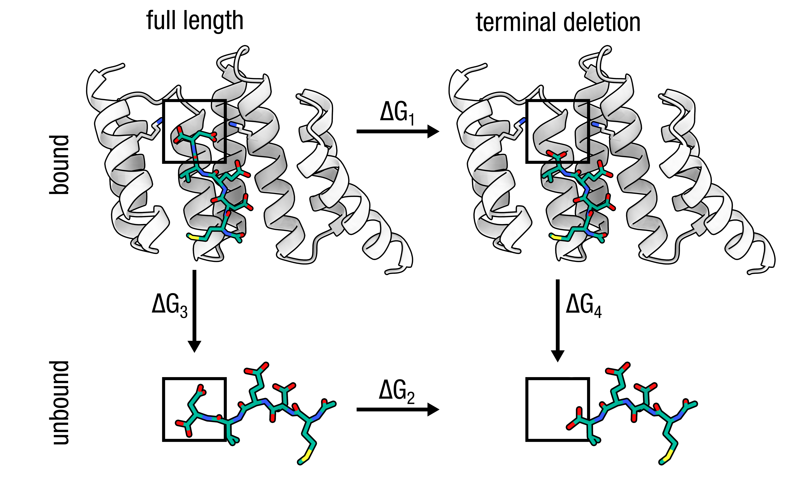

# Alchemical C-terminal residue deletion: HSP90 MEEVD peptide (1ELR)

<p align="center">
  
</p>

## TLDR

This example computes the free energy cost of truncating a C-terminal residue (Asp5) from the HSP90 MEEVD peptide, the one pmx workflow that uses the `DEL` mutation code and the `XdeC`/`XdeN` deletion-neighbour hybrids. Those hybrids are built on the fly by the generative covalent engine — a terminal deletion is just an internal→terminus residue morph — so no per-force-field pre-generation step is needed. The neighbouring Val4 becomes `VdeC` and grows a dummy C-terminal oxygen (`DOT2`) that becomes real in state B, while Asp5 is fully dummified — a physically distinct treatment from a standard residue swap.

| | |
|---|---|
| **Hybrid** | `VdeC` (on Val4) |
| **State A** | Val4 + Asp5 (fully interacting); charge −3 |
| **State B** | Val4 as new C-terminus; Asp5 dummified; charge −2 |
| **Charge shift** | −3 → −2 (+1), because Asp's side-chain carboxylate is lost |
| **Special steps** | None — the `VdeC` hybrid is generated on the fly by `pmx mutate` |

```bash
# Unique mutation step — see run.sh for the full pipeline
printf "5 DEL\n" > mut.txt
pmx mutate \
    -f  wt.gro \
    -o  mutant.pdb \
    --script mut.txt \
    -ff charmm36m-mut
```

---

## Detailed walkthrough

## Step 1 — Prepare the wildtype topology

Run `pdb2gmx` to normalise atom names (especially the backbone amide hydrogen) before passing the structure to `pmx mutate`. The output `.gro` is the only product needed from this step; `wt.top` is discarded.

```bash
eval "$(python3 -c 'from pmx.gmx import set_gmxlib; import os; set_gmxlib(); print("export GMXLIB="+os.environ["GMXLIB"])')"

gmx pdb2gmx \
    -f      input/1ELR_peptide.pdb \
    -o      wt.gro \
    -p      wt.top \
    -ff     charmm36m-mut \
    -water  tip3p \
    -ignh
```

---

## Step 2 — Build the hybrid structure

Target the residue to be **deleted** with the code `DEL`. `pmx` detects that Asp5 is the C-terminus and, through the generative covalent engine (`covalent.delete_terminal`), builds the deletion on the fly: the neighbour Val4 morphs internal → C-terminus (emitted as the `VdeC` hybrid into the force field's `nsaa.rtp`/`nsaa.mtp`, exactly like any other mutation), a dummy oxygen `DOT2` is placed on Val4, and Asp5 stays physically in the structure to be dummified later. No pre-generated `mutres_term` files are needed.

```bash
printf "5 DEL\n" > mut.txt
pmx mutate \
    -f      wt.gro \
    -o      mutant.pdb \
    --script mut.txt \
    -ff     charmm36m-mut
```

---

## Step 3 — Build the hybrid topology

> Steps 3 and 4 show the single-system case, which is what you want if you are
> running one leg on its own. For the doublebox in Step 5 they happen **once**, on
> the combined structure — see 5b. Do not do both.

`pmx mutate` already wrote the `VdeC` hybrid into the force field's `nsaa.rtp`, so `pdb2gmx` resolves it directly. Do **not** pass `-ignh` — the dummy atom `DOT2` placed by `pmx mutate` must be preserved.

```bash
gmx pdb2gmx \
    -f      mutant.pdb \
    -o      processed.gro \
    -p      topol.top \
    -ff     charmm36m-mut \
    -water  tip3p
```

---

## Step 4 — Fill B-state bonded terms

`pmx gentop` locates the `VdeC` hybrid (auto-discovered in the FF's `nsaa.mtp`), dummifies Asp5 in state B, and zeroes B-state force constants on dihedrals crossing the Val4–Asp5 boundary. The charge change (−3 → −2, Δq = +1) is discussed in the next step.

```bash
pmx gentop \
    -p  topol.top \
    -o  pmxtop.top \
    -ff charmm36m-mut
```

Expected output:
```
log_> Hybrid Residue -> 4 | VdeC
log_> Dummifying deletion target: 5 | ASP
log_> Making bonds for state B -> 30 bonds with perturbed atoms
log_> Making angles for state B -> 56 angles with perturbed atoms
log_> Making dihedrals for state B -> 49 dihedrals with perturbed atoms
log_> Removed 2 fake dihedrals
log_> Total charge of state A = -3
log_> Total charge of state B = -2
log_> Decoupling cross-residue dihedrals: VdeC (res 4) -- ASP (res 5)
log_> Zeroed B-state for 13 dihedrals
```

---

## Step 5 — The doublebox, and why it does not balance here

Deleting Asp5 shifts the system charge from −3 to −2 (Δq = +1). The terminal carboxylate
itself cancels — Val4 gains one as it becomes the new C-terminus — so the shift comes
entirely from **Asp's charged side chain**. Delete a neutral terminal residue and there is
no charge problem at all.

The textbook remedy is the **single-box double-system** method, in which the reference leg
runs the morph backwards so the two charge changes cancel inside one box:

```
                          alchemical λ: 0 → 1
  complex in box:  MEEVD (bound) ──────────────────►  MEEV (bound)    Δq = +1
  peptide in box:  MEEV  (free)  ──────────────────►  MEEVD (free)    Δq = −1
  ───────────────────────────────────────────────────────────────────────
  net charge change in box:                                                     0
```

> ⚠ **That second line is not currently buildable.** `MEEV → MEEVD` is an *insertion*, and
> `delete_terminal` has no insertion direction — `pmx mutate --reverse` now **raises** on a
> `DEL` target rather than silently ignoring the flag, which is what it used to do. Both
> legs of this example therefore delete, and the measured charges are state A = −6,
> state B = −4, i.e. Δq = **+2**, not 0.
>
> For a charge-changing terminal deletion today, run a **single box with charge-scaled
> (ECC) ions** instead; that is what the terminal showcase does. The doublebox below is
> kept because it is the right construction for a *neutral* deletion, where both legs
> shift nothing and the box balances trivially.

The reference is the **MEEVD peptide itself** (the same `1ELR_peptide.pdb`) free in water —
not a minimal dipeptide. The protein leg uses the **full co-chaperone complex** (TPR domain +
MEEVD peptide from 1ELR).

#### 5a — Prepare the reference leg (MEEVD peptide free in water)

```bash
# The reference is the same MEEVD peptide, free in solution
gmx pdb2gmx \
    -f      input/1ELR_peptide.pdb \
    -o      ref_wt.gro \
    -p      ref_wt.top \
    -ff     charmm36m-mut \
    -water  tip3p \
    -ignh

printf "5 DEL\n" > mut.txt
pmx mutate \
    -f      ref_wt.gro \
    -o      ref_mutant.pdb \
    --script mut.txt \
    -ff     charmm36m-mut
rm -f ref_wt.gro ref_wt.top

gmx pdb2gmx \
    -f      ref_mutant.pdb \
    -o      ref_processed.gro \
    -p      ref_topol.top \
    -ff     charmm36m-mut \
    -water  tip3p

pmx gentop \
    -p  ref_topol.top \
    -o  ref_pmxtop.top \
    -ff charmm36m-mut
```

#### 5b — Combine into one box, then build ONE topology

**Order matters.** Doublebox the two *mutant structures*, then run `pdb2gmx` once on the
combined file. A topology built per leg describes only half the system, so `grompp` would
reject it against the doubleboxed coordinates — there is nothing to merge afterwards if
you build it this way round.

```bash
pmx doublebox \
    -f1 mutant.pdb \
    -f2 ref_mutant.pdb \
    -o  doublebox.pdb \
    -r  2.5 \
    -d  1.5

# one topology covering both legs; two chains -> two terminus selection pairs
printf '0\n0\n0\n0\n' | gmx pdb2gmx \
    -f      doublebox.pdb \
    -o      doublebox.gro \
    -p      topol.top \
    -ff     charmm36m-mut \
    -water  tip3p \
    -ter

pmx gentop \
    -p  topol.top \
    -o  pmxtop.top \
    -ff charmm36m-mut
```

#### 5c — Solvate and add ions

```bash
gmx solvate -cp doublebox.gro -cs spc216.gro \
            -p pmxtop.top -o solvated.gro

gmx grompp -f mdp/em.mdp -c solvated.gro -r solvated.gro \
           -p pmxtop.top -o ions.tpr -maxwarn 1
printf '13\n' | gmx genion -s ions.tpr -pname K -nname CL \
           -neutral -conc 0.15 -o ions.gro -p pmxtop.top
```

---

## Step 6 — Energy minimise

```bash
gmx grompp -f mdp/em.mdp -c ions.gro -r ions.gro \
           -p pmxtop.top -o em.tpr -maxwarn 1
gmx mdrun -v -deffnm em -ntmpi 1
```

---

## Step 7 — Equilibrate and run endpoint simulations

```bash
mkdir -p stateA
gmx grompp -f mdp/eqA.mdp -c em.gro -r em.gro \
           -p pmxtop.top -o stateA/md.tpr -maxwarn 1
gmx mdrun -v -deffnm stateA/md

mkdir -p stateB
gmx grompp -f mdp/eqB.mdp -c em.gro -r em.gro \
           -p pmxtop.top -o stateB/md.tpr -maxwarn 1
gmx mdrun -v -deffnm stateB/md
```

---

## Step 8 — Non-equilibrium transition simulations

```bash
mkdir -p transitionA
printf '0\n' | gmx trjconv -f stateA/md.trr -s stateA/md.tpr \
    -b 5000 -sep -o transitionA/frame.pdb

for i in $(seq 0 99); do
    mkdir -p transitionA/frame${i}
    mv transitionA/frame${i}.pdb transitionA/frame${i}/initial.pdb
    gmx grompp -f mdp/tiA.mdp \
        -c transitionA/frame${i}/initial.pdb \
        -r transitionA/frame${i}/initial.pdb \
        -p pmxtop.top -o transitionA/frame${i}/ti.tpr -maxwarn 1
    gmx mdrun -v -deffnm transitionA/frame${i}/ti
done

mkdir -p transitionB
printf '0\n' | gmx trjconv -f stateB/md.trr -s stateB/md.tpr \
    -b 5000 -sep -o transitionB/frame.pdb

for i in $(seq 0 99); do
    mkdir -p transitionB/frame${i}
    mv transitionB/frame${i}.pdb transitionB/frame${i}/initial.pdb
    gmx grompp -f mdp/tiB.mdp \
        -c transitionB/frame${i}/initial.pdb \
        -r transitionB/frame${i}/initial.pdb \
        -p pmxtop.top -o transitionB/frame${i}/ti.tpr -maxwarn 1
    gmx mdrun -v -deffnm transitionB/frame${i}/ti
done
```

---

## Step 9 — Analyse

Because both legs (co-chaperone complex and free MEEVD peptide) run simultaneously in the
same box, `pmx analyze` operates on the combined work values and directly yields ΔΔG:

```bash
pmx analyze \
    -fA transitionA/frame*/ti.xvg \
    -fB transitionB/frame*/ti.xvg
```

```
ΔΔG = ΔG(Asp5 deletion in complex) − ΔG(Asp5 deletion of free peptide)
     = ΔΔG of co-chaperone binding: MEEV vs MEEVD
```

A positive ΔΔG means MEEV binds less tightly than MEEVD — the C-terminal Asp contributes
favourably to co-chaperone recognition.
