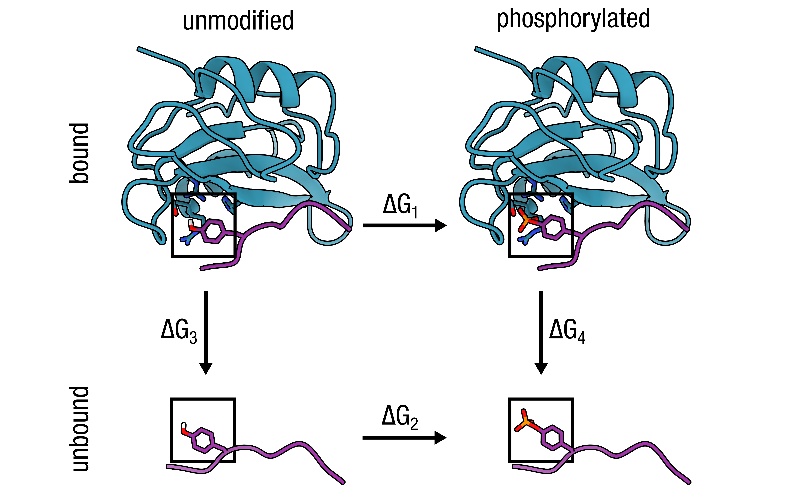

# Alchemical tyrosine phosphorylation: Tyr → phosphoTyr (YP1) in Lck SH2 domain (1AOT)

<p align="center">
  
</p>

## TLDR

This example computes the phosphorylation ΔΔG (Tyr → monoanionic phosphotyrosine YP1) using CHARMM36m's built-in YP1 residue in the Lck SH2 domain (PDB 1AOT) — no force-field patching required. The hybrid `Y2P1` morphs the tyrosine phenol into a phosphate by converting `HH` to a non-interacting dummy and promoting five dummy phosphate atoms (DP, DO2, DH2, DO3, DO4) to real ones, capturing the electrostatic change that drives SH2-domain phosphorylation recognition.

| | |
|---|---|
| **Hybrid** | `Y2P1` |
| **State A** | Tyr: `OH` type `OH1`, `HH` present; charge 0 |
| **State B** | YP1: `OH` → `ON2B`, `HH` → `DUM_H`, dummy `DP/DO2/DH2/DO3/DO4` → real; charge −1 |
| **Charge shift** | 0 → −1 — **doublebox required** (see below) |
| **Special steps** | None — YP1 is already in `charmm36m-mut`; use `P2` / `Y2P2` for dianionic (−2) form |

```bash
# Unique mutation step — see run.sh for the full pipeline
printf "115 P1\n" > mut.txt
pmx mutate \
    -f  wt.gro \
    -o  mutant.pdb \
    --script mut.txt \
    -ff charmm36m-mut
```

---

## Detailed walkthrough

### Step 1 — Fetch the structure and prepare the wildtype topology

Download 1AOT (Lck SH2 domain), then run `pdb2gmx` to normalise atom names. `wt.top` is discarded; only `wt.gro` feeds into `pmx mutate`.

```bash
bash input/fetch_input.sh   # downloads 1AOT, writes the complex + peptide, prints Tyr positions

eval "$(python3 -c 'from pmx.gmx import set_gmxlib; import os; set_gmxlib(); print("export GMXLIB="+os.environ["GMXLIB"])')"

gmx pdb2gmx \
    -f      input/1AOT_complex.pdb \
    -o      wt.gro \
    -p      wt.top \
    -ff     charmm36m-mut \
    -water  tip3p \
    -ignh
```

1AOT contains **chain F** (the SH2 domain, 106 residues) and **chain P** (the ligand
peptide EPQEEIPIYL). There is no chain A. `fetch_input.sh` writes both
`1AOT_complex.pdb` (F+P, the binding-competent system) and `1AOT_peptide.pdb` (P alone,
the free reference), and prints the tyrosine positions in pmx 1-based sequential
numbering: the ligand Tyr is **peptide residue 9**, which inside the complex — where
chain F's 106 residues come first — is **residue 115**.

The **same** tyrosine is phosphorylated in both legs. That is what closes the cycle and
makes the result a ΔΔG of binding; phosphorylating one of the SH2 domain's own
tyrosines in one leg and the ligand's in the other would not.

---

### Step 2 — Build the hybrid structure

Mutation code `P1` selects the `Y2P1` hybrid (Tyr → monoanionic phosphotyrosine). Residue
115 is the ligand tyrosine within the complex.

```bash
printf "115 P1\n" > mut.txt
pmx mutate \
    -f      wt.gro \
    -o      mutant.pdb \
    --script mut.txt \
    -ff     charmm36m-mut
```

`pmx mutate` changes `OH` from type `OH1` to the dummy-bearing `ON2B`, converts `HH` to a zero-charge dummy, and adds five dummy phosphate atoms around the phenol oxygen. Do **not** pass `-ignh` in subsequent steps.

---

### Step 3 — Build the hybrid topology

> Steps 3 and 4 show the single-system case. For the doublebox in Step 5 they
> happen **once**, on the combined structure — see 5b. Do not do both.

`pdb2gmx` reads the `Y2P1` residue definition from `mutres.rtp` in `charmm36m-mut` and generates a standard GROMACS topology.

```bash
gmx pdb2gmx \
    -f      mutant.pdb \
    -o      processed.gro \
    -p      topol.top \
    -ff     charmm36m-mut \
    -water  tip3p
```

---

### Step 4 — Fill B-state bonded terms

`pmx gentop` reads `Y2P1` from `mutres.mtp` and fills in all B-state atom types, charges, and bonded parameters.

```bash
pmx gentop \
    -p  topol.top \
    -o  pmxtop.top \
    -ff charmm36m-mut
```

Expected output:
```
log_> Hybrid Residue -> 115 | Y2P1
log_> Making bonds for state B -> ...
log_> Total charge of state A =  0
log_> Total charge of state B = -1
```

---

### Step 5 — Charge-neutral setup with pmx doublebox

Phosphorylation shifts the system charge from 0 to −1. In a periodic simulation box this
charge change introduces finite-size artefacts that can bias ΔG by several kJ/mol. The
correct approach is the **single-box double-system** method: place the protein system and a
reference peptide in the *same* box so that one gains charge while the other loses it,
keeping the total box charge constant throughout the alchemical transition.

```
                          alchemical λ: 0 → 1
  protein in box:   Tyr  ──────────────────────►  pTyr     Δq = −1
  reference in box: pTyr ──────────────────────►  Tyr      Δq = +1
  ─────────────────────────────────────────────────────────────────
  net charge change in box:                                    0  ✓
```

ΔΔG is recovered directly from the combined work values: `pmx analyze` sees the total
work of both simultaneous transformations. The reference (free peptide in solution) cancels
ΔG(phosphorylation in water), leaving ΔΔG of SH2 binding — how much more tightly the SH2
domain recruits the phosphorylated peptide vs. the unphosphorylated form.

#### 5a — Prepare the reference leg

The reference is the **Tyr-containing phosphopeptide extracted from 1AOT** — the biological
SH2 ligand in free solution, not a minimal ACE-Tyr-NME tripeptide. Using the actual peptide
captures the free energy of phosphorylation in the same sequence context and avoids
artefacts from end-cap chemistry. The combined ΔΔG directly quantifies the binding
preference of the SH2 domain for the phosphorylated vs. unphosphorylated form of the
ligand (see `input/fetch_input.sh` to extract the peptide from 1AOT).

```bash
gmx pdb2gmx \
    -f      input/1AOT_peptide.pdb \
    -o      ref_wt.gro \
    -p      ref_wt.top \
    -ff     charmm36m-mut \
    -water  tip3p \
    -ignh

# residue 9 is the peptide's tyrosine; --reverse makes this leg run pTyr -> Tyr,
# opposite the complex's Tyr -> pTyr, so the two charge changes cancel in one box
printf "9 P1\n" > ref_mut.txt
pmx mutate \
    -f       ref_wt.gro \
    -o       ref_mutant.pdb \
    --script ref_mut.txt \
    --reverse \
    -ff      charmm36m-mut
```

The reverse hybrid is named `P12Y` (the namer front-loads the target so a reverse hybrid
never collides with its forward counterpart), against `Y2P1` in the complex. Both states
then carry the same total charge, which is what makes the box neutral across the
transition.

#### 5b — Combine into one box, then build ONE topology

**Order matters.** Doublebox the two *mutant structures*, then run `pdb2gmx` once on the
combined file. That single call produces one topology covering both legs, so there is
nothing to merge afterwards — merging per-leg topologies by hand is exactly the step this
ordering removes.

```bash
pmx doublebox \
    -f1 mutant.pdb \
    -f2 ref_mutant.pdb \
    -o  doublebox.pdb \
    -r  2.5 \
    -d  1.5

# three chains (SH2 domain, bound peptide, free peptide) -> three terminus pairs
printf '0\n0\n0\n0\n0\n0\n' | gmx pdb2gmx \
    -f      doublebox.pdb \
    -o      doublebox.gro \
    -p      topol.top \
    -ff     charmm36m-mut \
    -water  tip3p \
    -ter

pmx gentop \
    -p  topol.top \
    -o  pmxtop.top \
    -ff charmm36m-mut
```

This places the complex and the free peptide in a single rectangular box separated by at
least 2.5 nm, with 1.5 nm to the box wall.

#### 5c — Solvate and add ions

```bash
# Solvate the combined box
gmx solvate -cp doublebox.gro -cs spc216.gro \
            -p pmxtop.top -o solvated.gro

# Add ions — system is charge-neutral by construction so no extra counter-ions needed
gmx grompp -f mdp/em.mdp -c solvated.gro -r solvated.gro \
           -p pmxtop.top -o ions.tpr -maxwarn 1
printf '13\n' | gmx genion -s ions.tpr -pname K -nname CL \
           -neutral -conc 0.15 -o ions.gro -p pmxtop.top
```

---

### Step 6 — Energy minimise

```bash
gmx grompp -f mdp/em.mdp -c ions.gro -r ions.gro \
           -p pmxtop.top -o em.tpr -maxwarn 1
gmx mdrun -v -deffnm em -ntmpi 1
```

---

### Step 7 — Equilibrate and run endpoint simulations

Tyrosine phosphorylation introduces a large electrostatic change; allow at least 10 ns equilibration per endpoint before harvesting transition frames.

```bash
mkdir -p stateA
gmx grompp -f mdp/eqA.mdp -c em.gro -r em.gro \
           -p pmxtop.top -o stateA/md.tpr -maxwarn 1
gmx mdrun -v -deffnm stateA/md

mkdir -p stateB
gmx grompp -f mdp/eqB.mdp -c em.gro -r em.gro \
           -p pmxtop.top -o stateB/md.tpr -maxwarn 1
gmx mdrun -v -deffnm stateB/md
```

---

### Step 8 — Non-equilibrium transition simulations

```bash
mkdir -p transitionA
printf '0\n' | gmx trjconv -f stateA/md.trr -s stateA/md.tpr \
    -b 5000 -sep -o transitionA/frame.pdb

for i in $(seq 0 99); do
    mkdir -p transitionA/frame${i}
    mv transitionA/frame${i}.pdb transitionA/frame${i}/initial.pdb
    gmx grompp -f mdp/tiA.mdp \
        -c transitionA/frame${i}/initial.pdb \
        -r transitionA/frame${i}/initial.pdb \
        -p pmxtop.top -o transitionA/frame${i}/ti.tpr -maxwarn 1
    gmx mdrun -v -deffnm transitionA/frame${i}/ti
done

mkdir -p transitionB
printf '0\n' | gmx trjconv -f stateB/md.trr -s stateB/md.tpr \
    -b 5000 -sep -o transitionB/frame.pdb

for i in $(seq 0 99); do
    mkdir -p transitionB/frame${i}
    mv transitionB/frame${i}.pdb transitionB/frame${i}/initial.pdb
    gmx grompp -f mdp/tiB.mdp \
        -c transitionB/frame${i}/initial.pdb \
        -r transitionB/frame${i}/initial.pdb \
        -p pmxtop.top -o transitionB/frame${i}/ti.tpr -maxwarn 1
    gmx mdrun -v -deffnm transitionB/frame${i}/ti
done
```

---

### Step 9 — Analyse

Because both legs (protein and reference peptide) run simultaneously in the same box,
`pmx analyze` operates on the combined work values and directly yields ΔΔG:

```bash
pmx analyze \
    -fA transitionA/frame*/ti.xvg \
    -fB transitionB/frame*/ti.xvg
```

The output ΔG is ΔΔG = ΔG(phosphorylation when bound to SH2) − ΔG(phosphorylation of the
free peptide in water). A negative ΔΔG means the SH2 domain specifically stabilises the
phosphorylated peptide — the thermodynamic signature of phospho-recognition and the direct
binding ΔΔG between the pTyr and Tyr forms of the ligand.
